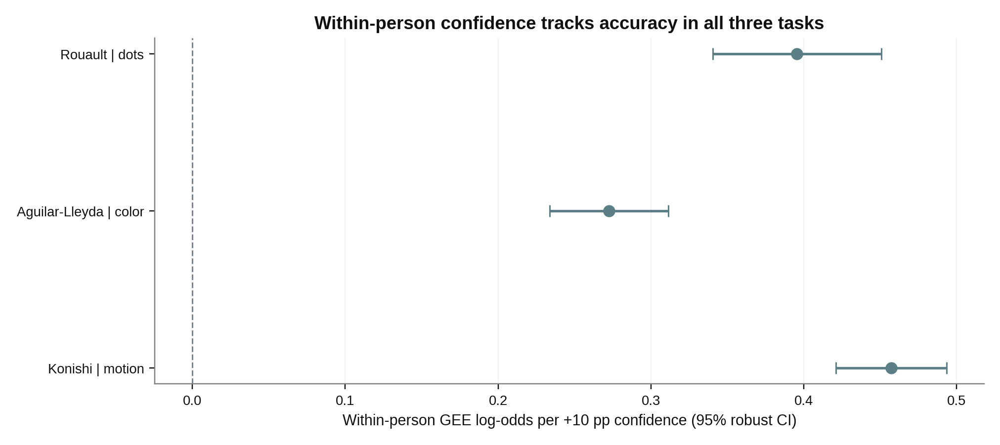

# The Confidence Paradox

**Does being more confident mean being more accurate—within a person or across people?**

*Kimia Pasandideh · BSc-level independent exploratory project · Computer Science & Mathematics, Université Paris-Saclay · 2026*

**Key finding.** Across three selected **visual perceptual decision tasks**, a person was more likely to respond correctly on trials where their confidence exceeded their own typical confidence. The **between-person** association was less certain in the three primary GEE models. **This is correlational and exploratory, not a causal effect or a novel discovery claim.**



*Primary GEE log-odds coefficients per +10 percentage points of within-person confidence, with participant-robust 95% CIs. Different people and tasks contribute to each study; this is not a meta-analysis.*

## Research question & approach

- **Within-person:** For the same individual, is a response more likely to be correct when their confidence is higher than their own average?
- **Between-person:** Do people who report higher average confidence tend to outperform others?
- **Method:** Three open secondary datasets; participant-mean centering; logistic GEE clustered by participant and adjusted for difficulty; random-intercept GLMM and sensitivity analyses as supplementary checks.

### Primary GEE results

| Primary dataset | Participants | Rated decisions | Within slope (95% CI) | Between slope (95% CI) |
|:--|--:|--:|--:|--:|
| Rouault 2019 · dot numerosity | 72 | 12,960 | +0.396 [0.341, 0.451] | +0.046 [-0.031, 0.124] |
| Aguilar-Lleyda 2018 · color | 28 | 11,200 | +0.273 [0.234, 0.311] | +0.037 [-0.037, 0.111] |
| Konishi 2019 · single motion | 93 | 22,320 | +0.457 [0.421, 0.493] | -0.055 [-0.169, 0.059] |

Coefficients represent **log-odds** for +10 percentage points confidence, **not changes in percentage-point accuracy**. These numbers are linked to `results/cross_study_primary_summary.csv`, and the validation tests check that this table stays consistent with computed outputs. For inference use the full [research report](report/Confidence_Paradox_Research_Report_CORRECTED.pdf).

## Run everything (one command)

**Python 3.10+**; initial dependency installation requires internet access.

```bash
python -m venv .venv
# Activate .venv (Windows PowerShell: .venv\Scripts\Activate.ps1)
python -m pip install -r requirements.txt
python run_all.py
```

The one command runs **Rouault GEE, exclusion sensitivity and numerical GLMM with participant-bootstrap**, **Aguilar-Lleyda color/letter GEE with 28-cluster sensitivity**, **Konishi primary/supplementary GEE with session centering sensitivity**, creates the summary CSV, refreshes **all canonical figures**, rebuilds the **four-page PDF**, and runs output checks. Full GLMM = **500** participant bootstrap draws, Aguilar color = **300** draws, with fixed seeds.

Quick **installation-only smoke test** (CI intervals from this run are *not* research results):

```bash
python run_all.py --glmm-bootstrap 20 --aguilar-bootstrap 30
```

Run the **full default command again** before interpreting or quoting final intervals. `results/generated/` is ignored by Git, so freshly generated CSVs stay local; `results/cross_study_primary_summary.csv` and the PDF and figures are tracked as examples of full-run outputs.

## Important statistical caveat: GEE vs GLMM

An earlier **variational-Bayes** GLMM gave an implausibly tight between-person interval. We **do not use it** as proof. An independently fitted adaptive-Gauss–Hermite **maximum-likelihood GLMM** on Rouault and participant-level bootstrap gave a between-person coefficient around **+0.151**, with 95% percentile interval close to **[+0.002, +0.297]** (500 draws, fixed seed). The marginal GEE between-person effect was around **+0.046 [-0.031, +0.124]**. The GLMM bootstrap interval's lower limit is **very near zero**, and GEE versus GLMM target different conditional vs population-average log-odds. **The between-person sign is therefore not a robust cross-method conclusion.** See [statistical audit](STATISTICAL_AUDIT.md).

Other sensitivity work: four Rouault participant-quality screens (not the original paper's 46-subject screening); color GEE resampling **whole participants** in Aguilar-Lleyda (only 28 clusters, so cautious inference); and additional Konishi within-**participant-and-session** centering, with cluster inference **by original person**.

## Repository guide

| Path | What you will find |
|---|---|
| `data/` | Original unmodified CSVs (source CC0); see provenance below |
| `source_documentation/` | Contributor-provided README files |
| `scripts/rouault_models.py` | Rouault primary GEE, contrasts, sensitivity, ML GLMM & participant bootstrap |
| `scripts/aguilarlleyda_gee.py` | Color & letter GEE, joint contrast, color participant-cluster bootstrap |
| `scripts/konishi_gee.py` | Motion primary, other conditions and session-centering sensitivity |
| `scripts/summarize_studies.py` | Summary CSV and main scientific figure from model outputs |
| `scripts/build_report.py` | Report generated **from computed CSVs**, never fixed model coefficients |
| `run_all.py` | One-command pipeline including tests and figure synchronization |
| `tests/validate_outputs.py` | Integrity checks for input tables, output values, report and graph files |
| `figures/` | Consistently styled figures (graphical summaries, not invented data) |
| `report/` | Four-page research report |
| `STATISTICAL_AUDIT.md` | Explicit model disagreement and interpretation limitations |
| `REPRODUCIBILITY_NOTES.md` | Provenance, dependency versions, audit approach |

## How far can these results generalize?

We investigated **visual perceptual decisions only**. These results do **not** establish claims about AI trust, economic choices, interpersonal confidence, emotional decisions, or that making a person more confident causes better performance. Within-person discrimination and average confidence-versus-accuracy *calibration* are different quantities. The analyses were **not preregistered**, nor independently peer-reviewed. Mixed models, model selection and multiplicity have limitations documented in the report.

## Research sources, rights & attribution

The [Confidence Database (OSF)](https://osf.io/s46pr/) is distributed under **CC0 1.0**. Its authors explicitly permit re-use and request citation of both the database paper and original studies (Rahnev et al., 2020, *Nature Human Behaviour*, DOI [10.1038/s41562-019-0813-1](https://doi.org/10.1038/s41562-019-0813-1)). The individual contributor READMEs are retained with source citations: Rouault, Dayan & Fleming (2019); Aguilar-Lleyda, Lemarchand & de Gardelle (2018); Konishi et al. (2019). Original investigators designed and collected the experiments; no original data collection is claimed here. Source hashes are in `SHA256_SOURCE_FILES.txt`.

**Authorship and AI transparency:** This is an independent *student project* developed using AI assistance for analysis coding, debugging, graphics and report generation. It is **not a published paper**. The student should independently reproduce and understand the reported methods before citing the work in applications. No GitHub upload has been performed automatically.
